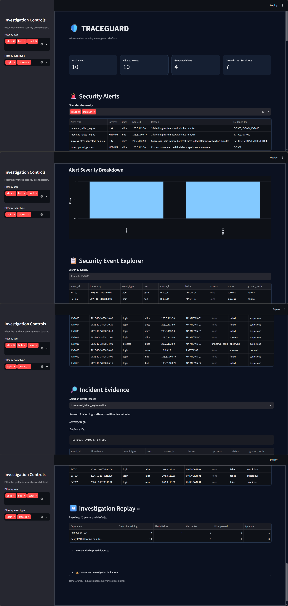

TRACEGUARD

An Evidence-First, Replayable Security Investigation Toolkit

TRACEGUARD is a Python-based security investigation toolkit that analyzes synthetic security logs, identifies patterns matching configurable detection rules, connects related events through an evidence graph, and generates structured incident reports.

The project focuses on transparent detection, traceable evidence, repeatable investigation, and clear limitations. An alert indicates a pattern that matches a rule; it does not prove that a real security breach occurred.

Key Features

- Rule-Based Detection: Flags repeated failed logins, successful logins following repeated failures, and events involving configured suspicious processes.
- Evidence Graph: Uses NetworkX to connect events with users, source IP addresses, and devices.
- Time-Aware Investigation: Examines related events within a configurable time window.
- Incident Reporting: Generates structured JSON reports containing alert details and supporting event references.
- Evidence Validation: Checks cited event IDs and their details against the source dataset.
- Investigation Replay: Examines how changes to available events, such as removing or delaying events, affect generated alerts.
- Evaluation: Calculates event-level precision, recall, and F1 score against synthetic test labels.
- Automated Tests: Uses Python's "unittest" framework to test detection logic, graph relationships, and incident-report validation.
- Visualization: Creates graph visualizations and provides an interactive Streamlit dashboard for investigation.

Technology Stack

- Python
- Pandas
- NetworkX
- Matplotlib
- Streamlit
- unittest

Dashboard Preview

The screenshot below shows the TRACEGUARD investigation dashboard.

Project Structure

TRACEGUARD/
├── data/
│   ├── raw/
│   │   ├── security_events.csv
│   │   └── test_security_events.csv
│   └── processed/
├── reports/
│   ├── dashboard_full.png
│   ├── evidence_graph.png
│   └── incident_report.json
├── src/
│   ├── detection_engine.py
│   ├── evaluation.py
│   ├── evidence_graph.py
│   ├── incident_report.py
│   ├── investigation_replay.py
│   └── visualize_graph.py
├── tests/
│   ├── test_detection_engine.py
│   ├── test_evidence_graph.py
│   └── test_incident_report.py
├── generate_logs.py
├── generate_test_logs.py
├── requirements.txt
└── run_traceguard.py

Getting Started on Windows

Requirements

- Python 3.13
- pip

1. Download the repository

Clone the repository or download it as a ZIP file and extract it. Open PowerShell in the project folder.

2. Create a virtual environment

py -3.13 -m venv .venv
.\.venv\Scripts\Activate.ps1

If Python 3.13 is not installed, install a compatible Python version and adjust the commands accordingly.

3. Install dependencies

python -m pip install -r requirements.txt

4. Generate the synthetic security logs

python generate_logs.py
python generate_test_logs.py

5. Run the investigation workflow

python run_traceguard.py

The runner executes the detection, evaluation, evidence-graph visualization, incident-report, and investigation-replay scripts in sequence.

6. Launch the interactive dashboard

python -m streamlit run src/dashboard.py

If the dashboard file has a different name or location in your local project, use the actual dashboard script path.

Responsible Use and Limitations

TRACEGUARD is an educational project that uses synthetic security logs. Its rule-based alerts identify patterns matching the implemented detection logic; they do not establish that a real compromise occurred. Evaluation results depend on the synthetic labels and test cases provided. They should not be interpreted as proof of real-world detection performance.

Use the project for learning, testing, and authorized defensive investigation.

Future Improvements

- Expand test coverage with additional edge cases.
- Evaluate detection rules on larger and more varied datasets.
- Improve configuration and documentation for investigation workflows.
- Explore additional detection rules while preserving explainable evidence.

Author

Vineet Thakran

Developed as a Python cybersecurity and data-analysis portfolio project.

GitHub: "@vinit14thk" (https://github.com/vinit14thk)
